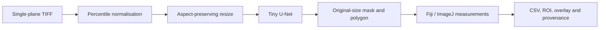

# Organoid Image Analysis — Final Year Project

**Syazani Akmal · Work in progress · Mechatronics FYP**

A research prototype for segmenting organoids in microscope TIFF images and extracting eight 2D morphometric measurements with Fiji/ImageJ. This repository records the working software, dataset organisation, experiments and decisions throughout the project.

> **Current status:** six annotated images used for pilot fitting; no held-out validation or test set. Measurements are experimental and require boundary review and verified calibration. Prediction of biological outcomes remains a possible extension, not an implemented or approved project scope.

## Returning to this project

Read the [daily working guide](docs/WORKING_GUIDE.md) for folder explanations, running the prototype and updating GitHub. For Codex in Antigravity or a fresh editor session, start with [AGENTS.md](AGENTS.md) and the [project handover](docs/PROJECT_HANDOVER.md). The handover explains the current FYP scope, evidence, limitations and next decisions.

## Start here

| Your purpose | Read or run |
|---|---|
| Supervisor overview and next decisions | [Project status](docs/PROJECT_STATUS.md) and [roadmap](docs/ROADMAP.md) |
| Run the measurement prototype | [Setup and usage](docs/SETUP.md), `src/prototype_app.py` |
| Inspect the CNN and its calculations | `src/network_visualizer.py` |
| Understand the dataset | [Data guide](data/README.md) and [known issues](data/DATA_NOTES.md) |
| Review pilot evidence | [Six-image comparison](experiments/six-image-pilot/SUMMARY.md) |
| Check implementation and model | [Architecture](docs/ARCHITECTURE.md), [model card](models/README.md) |
| Continue the project | [Working guide](CONTRIBUTING.md), [experiment log](experiments/log.csv) |

## What the prototype does



Outputs: **area, perimeter, circularity, aspect ratio, roundness, solidity, Feret and MinFeret**. A local browser interface supports image uploads, calibration confirmation and export. A second interface shows the network's activations and arithmetic.

## Quick start

Windows + Python with PyTorch support + Fiji including Java are required for the complete measurement workflow. See [setup](docs/SETUP.md) for data access and full instructions.

```powershell
python -m venv .venv
.\.venv\Scripts\Activate.ps1
python -m pip install -r requirements.txt
$env:FIJI_HOME = 'C:\path\to\Fiji'
python scripts/import_local_data.py --source 'C:\path\to\original\FYP'
python src/prototype_app.py
```

Open `http://127.0.0.1:8765`. For the CNN inspector: `python src/network_visualizer.py` (port 8770).
The checkpoint is included; raw lab images are supplied separately. A fresh clone needs the pilot files for examples, training and integration checks. Uploaded TIFF inference does not require those examples.

## Repository layout

```text
src/                 measurement app, CNN inspector, model and training code
models/              selected pilot checkpoint, fitting history and model card
data/                dataset guide, inventories and annotation metadata
  metadata/          tracked manifests; no raw TIFF payloads
  pilot/             local images, masks, Fiji ROIs and measurement CSVs
  raw/               optional local full dataset
experiments/         pilot evidence and experiment log
results/             reproducible exports; local outputs ignored by Git
scripts/             local data import and repository checks
tests/               existing measurement and CNN verification scripts
docs/                status, roadmap, architecture and setup
  meetings/          supervisor meeting template
  progress/          progress update template
  literature/        literature review template
reports/             guide for reviewed reports and presentation exports
.github/             issue templates, pull request template and syntax checks
```

## Evidence and limitations

- The saved dataset audit describes 750 main images, each 2048 × 1536; additional subfolders are listed separately in the inventory.
- The annotation pilot contains 20 selected images and six masks/ROIs. Expert review is pending.
- Saved exported-mask comparison averages about 97.06% Dice **on the same six training images**. This is not unseen-image accuracy.
- A04 has about 89.71% training-image mask Dice and substantial perimeter/circularity error.
- Original measurement CSVs have mixed-unit and selection issues; see the [data notes](data/DATA_NOTES.md).
- The separate NC004 workbook has not been matched to these toxicity TIFFs.

## Verification

The reorganised code passed the existing CNN arithmetic and Fiji integration checks. See [verification evidence](docs/VERIFICATION.md).

## Development and sharing

Use short feature branches, meaningful commits and the experiment/progress templates. Keep raw data, private meeting material and generated output out of routine commits. The original FYP folder is preserved; this is a curated working copy. See [migration notes](docs/MIGRATION.md) for included and excluded material.

Code and lab-data redistribution terms have not been selected or confirmed. No open-source licence is asserted for this repository. The repository structure takes inspiration from the team's [Solar Filament project](https://github.com/amiruliman592/Kaggle-Competition-); its code and results are not copied here.
