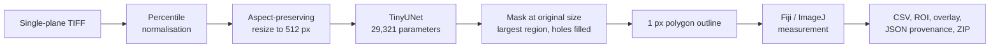

# Organoid Image Analysis

[](https://github.com/zaniakmal08-blip/fyp-organoid-analysis/actions/workflows/checks.yml)


**Final Year Project · Syazani Akmal · Mechatronics Engineering**

Automatic segmentation of organoids in brightfield microscope images, followed by eight 2D shape measurements computed by Fiji/ImageJ. The goal is to replace slow, hand-traced measurement with a repeatable pipeline that a researcher can still inspect and correct.

> **Project status — pilot prototype.** The model was fitted on six annotated images and has **no held-out validation or test set yet**. Every score in this repository is a training-image score, not accuracy on unseen images. Measurements need boundary review and a verified calibration before any scientific use.

## Contents

- [What it does](#what-it-does)
- [Quick start](#quick-start)
- [Repository layout](#repository-layout)
- [Source code map](#source-code-map)
- [Current results](#current-results)
- [Testing](#testing)
- [Roadmap](#roadmap)
- [Documentation](#documentation)
- [Data, licence and acknowledgements](#data-licence-and-acknowledgements)

## What it does



| Component | Description | Start with |
|---|---|---|
| **Measurement app** | Local browser app: upload a TIFF, confirm the µm/pixel scale, review the predicted outline, export results. | `python src/prototype_app.py` |
| **CNN inspector** | Shows every layer's activations and re-derives any output pixel by hand from the stored weights. A learning and debugging tool. | `python src/network_visualizer.py` |
| **Training script** | Fits the U-Net with a boundary-weighted BCE + Dice loss and writes a candidate checkpoint. | `python src/train_prototype.py` |

Measurements produced for each organoid:

| Measurement | Meaning | Unit |
|---|---|---|
| Area | Size of the 2D region | µm² |
| Perimeter | Boundary length | µm |
| Circularity | 4π·area / perimeter² (1 = perfect circle) | – |
| Aspect ratio | Major / minor axis of the fitted ellipse | – |
| Roundness | 4·area / (π·major axis²) | – |
| Solidity | Area / convex-hull area | – |
| Feret | Longest caliper diameter | µm |
| MinFeret | Shortest caliper diameter | µm |

These are measurements of a 2D outline. They do not by themselves establish 3D volume, viability, differentiation or treatment response.

## Quick start

**Requirements:** Windows, Python 3.10+ and [Fiji](https://fiji.sc/) (with its bundled Java) for the measurement step. The trained checkpoint is included; lab images are not (see [data](#data-licence-and-acknowledgements)).

```powershell
git clone https://github.com/zaniakmal08-blip/fyp-organoid-analysis.git
cd fyp-organoid-analysis

python -m venv .venv
.\.venv\Scripts\Activate.ps1
python -m pip install -r requirements.txt

$env:FIJI_HOME = 'C:\path\to\Fiji'
python src/prototype_app.py
```

Open <http://127.0.0.1:8765>, upload a single-plane TIFF, confirm the scale and export. For the CNN inspector run `python src/network_visualizer.py` and open <http://127.0.0.1:8770>.

To use the built-in examples, train or run the integration checks, restore the pilot data first:

```powershell
python scripts/import_local_data.py --source 'C:\path\to\original\FYP'
```

Full instructions, environment variables and troubleshooting: [docs/SETUP.md](docs/SETUP.md).

## Repository layout

```text
fyp-organoid-analysis/
├── src/                  application, model, training and measurement code
├── tests/                unit tests and integration checks
├── scripts/              data import and repository checks
├── models/               selected checkpoint, training history, model card
├── data/
│   ├── metadata/         tracked inventories, manifests and audit records
│   ├── pilot/            local images, masks, ROIs, CSVs (not in Git)
│   └── raw/              optional full dataset (not in Git)
├── experiments/          experiment log and recorded evidence
├── results/              selected evidence; results/local/ is scratch (not in Git)
├── docs/                 setup, architecture, status, roadmap, guides
│   ├── progress/         dated progress notes
│   ├── meetings/         supervisor meeting notes
│   └── literature/       reading register
├── reports/              reviewed reports and presentation exports
├── .github/              CI workflow, issue and pull-request templates
├── .vscode/              shared run configurations (F5) for VS Code / Antigravity
├── AGENTS.md             instructions for AI coding assistants
├── CHANGELOG.md          notable changes
└── pyproject.toml        formatter, linter and test configuration
```

## Source code map

| File | Responsibility |
|---|---|
| [`src/organoid_core.py`](src/organoid_core.py) | **The pipeline.** `load_model()` and `analyse()` — read this first. |
| [`src/model.py`](src/model.py) | `TinyUNet` network definition. |
| [`src/preprocessing.py`](src/preprocessing.py) | TIFF validation, normalisation, letterbox resize. |
| [`src/imagej_bridge.py`](src/imagej_bridge.py) | Calls Fiji/ImageJ through `imagej_helper/MeasureOrganoid.java`. |
| [`src/project_paths.py`](src/project_paths.py) | All folder locations and their environment-variable overrides. |
| [`src/prototype_app.py`](src/prototype_app.py) + `prototype_ui.html` | Measurement app server and page. |
| [`src/network_visualizer.py`](src/network_visualizer.py) + `network_visualizer.html` | CNN inspector server and page. |
| [`src/train_prototype.py`](src/train_prototype.py) | Current training script. |
| `src/train_three.py`, `src/predict_image.py` | Legacy three-image baseline, kept for comparison only. |

How the pieces fit together, the checkpoint format and the HTTP endpoints are described in [docs/ARCHITECTURE.md](docs/ARCHITECTURE.md).

## Current results

Six-image pilot, evaluated **on the same six images used for fitting** ([full table](experiments/six-image-pilot/SUMMARY.md)):

| Image | Mask Dice | Area error | Perimeter error |
|---|---:|---:|---:|
| A01 · H₂O₂ 0 µM · day 1 | 98.63% | −1.17% | +0.26% |
| A02 · H₂O₂ 12.5 µM · day 2 | 98.97% | +1.29% | +0.79% |
| A03 · H₂O₂ 25 µM · day 4 | 98.48% | +2.27% | +4.00% |
| A04 · H₂O₂ 50 µM · day 5 | 89.71% | −18.28% | +65.51% |
| A05 · H₂O₂ 100 µM · day 6 | 97.68% | −3.63% | −4.43% |
| B07 · ROT 0 nM · day 1 | 98.87% | +0.52% | −0.54% |

Known limitations:

- **No independent evaluation.** Mean Dice of about 97% describes fitting, not generalisation.
- **A04 is a clear failure case**, with large perimeter and circularity errors.
- **Calibration is provisional** (about 0.619 µm/pixel) and has not been verified by the lab.
- **Reference CSVs have unit and selection problems** — see [data/DATA_NOTES.md](data/DATA_NOTES.md).
- Annotations have not yet been reviewed by an expert.

## Testing

```powershell
python -m pip install -r requirements-dev.txt

python -m pytest                              # unit tests: no lab data or Fiji needed
python scripts/check_repository.py            # syntax, doc links, manifest, checkpoint hash
python tests/verify_network_visualizer.py     # needs pilot data
python tests/verify_prototype.py              # needs pilot data + Fiji
ruff check . ; ruff format .                  # lint and format
```

GitHub Actions runs the first two plus the style check on every push. The last two integration checks run locally because they need lab images and Fiji. Latest recorded results: [docs/VERIFICATION.md](docs/VERIFICATION.md).

## Roadmap

- [x] Local segmentation and measurement prototype
- [x] Six-image pilot with documented limitations
- [x] Organised, documented and tested repository
- [ ] Confirm final scope and success criteria with supervisor
- [ ] Agree annotation protocol; verify calibration
- [ ] Expand reviewed annotations
- [ ] Group-separated train / validation / test split
- [ ] Classical and learning baselines on the same split
- [ ] Unseen-image evaluation of segmentation and all eight measurements

Details and the suggested order of work: [docs/ROADMAP.md](docs/ROADMAP.md).

## Documentation

| I want to… | Read |
|---|---|
| Install and run everything | [docs/SETUP.md](docs/SETUP.md) |
| Understand how the code works | [docs/ARCHITECTURE.md](docs/ARCHITECTURE.md) |
| Know the day-to-day workflow (folders, Git, recording progress) | [docs/WORKING_GUIDE.md](docs/WORKING_GUIDE.md) |
| See what is done and what is undecided | [docs/PROJECT_STATUS.md](docs/PROJECT_STATUS.md) |
| Get full project context (for a new collaborator or AI assistant) | [docs/PROJECT_HANDOVER.md](docs/PROJECT_HANDOVER.md), [AGENTS.md](AGENTS.md) |
| Understand the dataset and its known problems | [data/README.md](data/README.md), [data/DATA_NOTES.md](data/DATA_NOTES.md) |
| Read about the selected model | [models/README.md](models/README.md) |
| Contribute a change | [CONTRIBUTING.md](CONTRIBUTING.md) |

## Data, licence and acknowledgements

Microscope images, masks, ROIs and measurement CSVs are **not** in this repository; only inventories and checksums are tracked. Access is arranged separately with the lab. No public redistribution permission is assumed.

No open-source licence has been selected yet, so the code is shared for viewing and assessment only. The repository history and how it was curated from the original working folder are recorded in [docs/MIGRATION.md](docs/MIGRATION.md).

Measurements are computed by [Fiji/ImageJ](https://fiji.sc/). The repository structure was inspired by the team's [Solar Filament project](https://github.com/amiruliman592/Kaggle-Competition-); no code or results are shared between the two.
