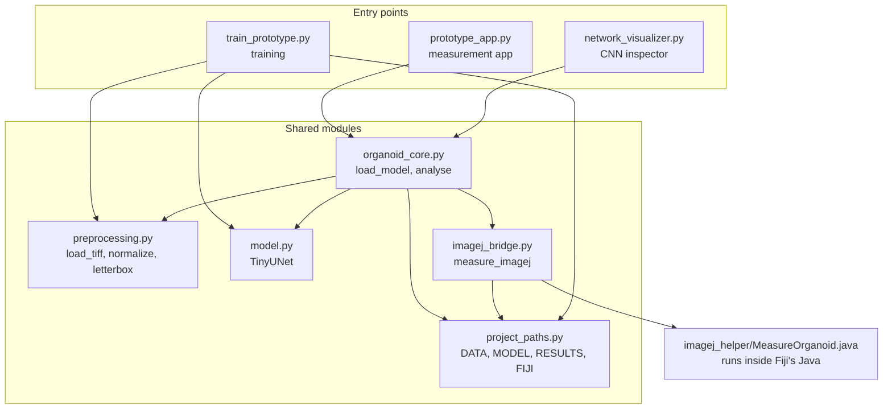

# Architecture

How the code is organised, how data flows through it and where to make common changes. For installation see [SETUP.md](SETUP.md).

## Overview

The project is a set of plain Python scripts in `src/`, run from the repository root. There is no package to install: each entry-point script imports its neighbours directly.



## Modules

| Module | Contains | Notes |
|---|---|---|
| `project_paths.py` | `REPO`, `DATA`, `MODEL`, `RESULTS`, `FIJI` | The only place paths are defined. Overridable with `FYP_DATA_DIR`, `FYP_MODEL_PATH`, `FYP_RESULTS_DIR`, `FIJI_HOME`. |
| `model.py` | `TinyUNet`, `conv_block` | Two-level U-Net, 29,321 parameters. Attribute names are checkpoint keys — do not rename. |
| `preprocessing.py` | `load_tiff`, `normalize`, `letterbox` | Defines the `letterbox_percentile_v1` preprocessing shared by training and inference. |
| `imagej_bridge.py` | `measure_imagej`, `imagej_paths`, `FIELDS`, `UNITS` | Starts a headless Java process. Windows-only at present. |
| `organoid_core.py` | `load_model`, `predict_probability`, `analyse` | The full pipeline for one image. Re-exports the helpers above. |
| `prototype_app.py` | HTTP server for `prototype_ui.html` | Port 8765, localhost only. |
| `network_visualizer.py` | HTTP server for `network_visualizer.html` | Port 8770, localhost only, read-only. |
| `train_prototype.py` | Current training script | Fits all paired masks; no held-out split yet. |
| `train_three.py`, `predict_image.py` | Legacy three-image baseline | Square-resize preprocessing; incompatible with the app. `train_three.NAMES` is still used by the integration checks. |

Each HTML page lives next to its Python server and is served by it. Keep them together.

## The pipeline, step by step

`organoid_core.analyse()` performs these steps for one uploaded image:

| # | Step | Detail |
|---|---|---|
| 1 | Load and validate | Single-plane TIFF only, at most 30 megapixels, must have intensity variation. RGB is averaged to grayscale. OME pixel size is read as a *suggestion*. |
| 2 | Check the scale | The operator-confirmed µm/pixel must be finite, positive and at most 1000. |
| 3 | Normalise | Clip to the 1st–99th intensity percentiles and rescale to 0–1. |
| 4 | Letterbox | Resize so the longer side equals the model size (512), pad the rest with zeros. No distortion. |
| 5 | Predict | `TinyUNet` → logits → sigmoid → probability map. |
| 6 | Restore | Remove the padding and resize the probability map back to original image dimensions. |
| 7 | Threshold | Probability ≥ 0.5 is organoid. |
| 8 | Select region | Keep the largest external contour (at least 16 px² area) and fill interior holes. |
| 9 | Polygon | Simplify the outline with a 1-pixel tolerance; vertices are written at pixel centres. |
| 10 | Measure | Fiji/ImageJ measures the polygon with the confirmed calibration. |
| 11 | Export | Files below, plus warnings (edge contact, discarded regions, filled holes). |

### Files written per analysis

Each run gets its own folder under `results/local/predictions/<timestamp>_<id>/`:

| File | Content |
|---|---|
| `input.tif` | Exact uploaded bytes |
| `input_preview.png` | Normalised grayscale preview |
| `probability.npy` | Probability map at original size |
| `raw_mask.png` | Thresholded mask before region selection |
| `mask.png` | Final measured region |
| `roi_vertices.csv` | Polygon vertices sent to ImageJ |
| `predicted.roi` | Fiji-compatible ROI (open it in Fiji to review) |
| `overlay.png` | Outline drawn on the image |
| `measurements.json` | Raw values returned by ImageJ |
| `measurements.csv` | One row: the eight values, scale and review status |
| `result.json` | Everything above plus provenance: input hash, model hash, scale source, warnings |
| `results.zip` | All of the files in one download |

## Model

```text
input (1 ch)
  └─ e1: conv-relu-conv-relu (8 ch) ───────────────────────────────┐ skip
       └─ pool ─ e2 (16 ch) ───────────────────────┐ skip          │
                  └─ pool ─ middle (32 ch)          │               │
                             └─ u2 (up ×2, 16 ch) ─ cat ─ d2 (16 ch)│
                                                     └─ u1 (up ×2, 8 ch) ─ cat ─ d1 (8 ch)
                                                                           └─ out: 1×1 conv → logit
```

Input height and width must be divisible by four. The output is a logit; `sigmoid` gives the organoid probability.

### Checkpoint format

`models/tiny_unet.pt` is a dictionary saved with `torch.save`:

| Key | Meaning |
|---|---|
| `model_state` | `TinyUNet` weights |
| `size` | Model input size in pixels (512) |
| `preprocessing` | Must be `letterbox_percentile_v1` for the app to load it |
| `roi_representation` | `polygon_1px` — how the mask becomes a measured region |
| `names` | Training image names (also the app's example list) |
| `sources` | SHA-256 of every training image and mask |
| `seed`, `epochs`, `learning_rate`, `dice_weight`, `warm_start` | Training settings |
| `selected_epoch`, `selection` | Which epoch was kept and why |
| `boundary_loss`, `experiment` | Human-readable descriptions |

`load_model()` adds `_model_sha256` and `_model_path` at load time for provenance.

### Training

`train_prototype.py` loads every `<data>/masks/<name>.png` with its `<data>/images/<name>.tif`, applies the same preprocessing as inference and minimises

```text
loss = boundary-weighted BCE + dice_weight × (1 − Dice)
```

Pixels within a 7-pixel band around the mask boundary get 8× weight, because the boundary determines perimeter and shape measurements. Adam with cosine learning-rate decay, batch size 2, seed 42. The epoch with the highest mean *training* Dice is kept. Output goes to `results/local/model_candidate/`; promoting a candidate into `models/` is a deliberate manual step (update the hash in `models/README.md` and the experiment log).

## HTTP endpoints

Both servers use Python's built-in `http.server`, bind to `127.0.0.1` and reject cross-origin POST requests. They are single-user research tools, not deployable services.

**Measurement app — `prototype_app.py` (8765)**

| Method | Path | Purpose |
|---|---|---|
| GET | `/` | User interface |
| GET | `/api/examples` | Example image names and model hash |
| GET | `/example/<name>` | An example TIFF from the pilot data |
| GET | `/files/<run>/<file>` | A previously exported file |
| POST | `/api/inspect?name=` | Preview and metadata scale for an uploaded TIFF |
| POST | `/api/analyse?name=&sx=&sy=&source=` | Run the pipeline |

**CNN inspector — `network_visualizer.py` (8770)**

| Method | Path | Purpose |
|---|---|---|
| GET | `/` | User interface |
| GET | `/api/model` | Parameter counts and layer list |
| GET | `/api/example?name=` | Forward pass on a pilot image |
| POST | `/api/upload?name=` | Forward pass on an uploaded TIFF |
| GET | `/api/calculate?run=&op=&channel=&y=&x=&input=` | Hand calculation for one output value |
| GET | `/api/output?run=&y=&x=` | Logit → probability → mask value |
| GET | `/api/code?name=` | Source of a pipeline file |
| GET | `/weights.npz` | All weights |

## Where to change things

| Goal | Edit | Then |
|---|---|---|
| Change threshold, minimum area or polygon tolerance | constants at the top of `organoid_core.py` | Run `tests/verify_prototype.py`; record as an experiment — measurements will change |
| Change preprocessing | `preprocessing.py` | Give it a new preprocessing name, retrain, update `PREPROCESSING` in `organoid_core.py` |
| Try a different network | New class in `model.py` | Train to a new checkpoint; keep `TinyUNet` so the existing checkpoint still loads |
| Add a train/validation split | `train_prototype.py` | Record the split in the checkpoint and experiment log |
| Add or change a measurement | `MeasureOrganoid.java` and `FIELDS`/`UNITS` in `imagej_bridge.py` | Update `CSV_COLUMNS` in `organoid_core.py` and the UI |
| Change the web page | `prototype_ui.html` / `network_visualizer.html` | Reload the browser; no build step |
| Support macOS/Linux | `imagej_paths()` in `imagej_bridge.py` | Test against a real Fiji installation |

## Design constraints

- **Measurement is delegated to ImageJ** so results are comparable with the manual Fiji workflow.
- **Calibration is never trusted automatically.** Metadata scale is offered to the operator, who must confirm it.
- **Every result carries provenance** (input hash, model hash, scale source, post-processing) so a number can be traced to what produced it.
- **Original data is immutable.** Generated output goes to `results/local/`, which Git ignores.
- A 2D mask does not measure 3D volume, neuron fraction, viability or differentiation.
